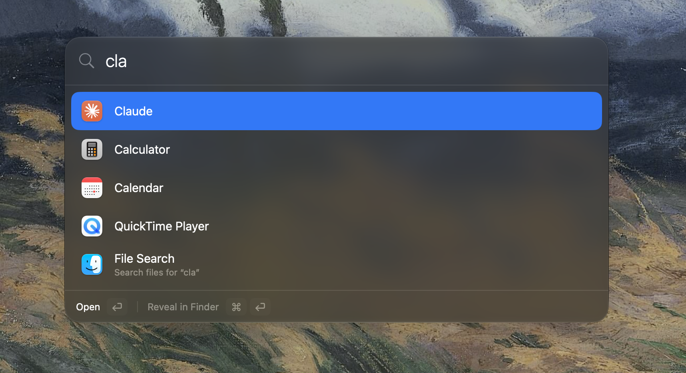

<p align="center">

<h1 align="center">Launch</h1>
</p>

#### Supported Platforms





A Spotlight-style launcher for macOS. Press ⌘Space, type, press Return.

**Links**
- Download: [Latest release](https://github.com/StefKors/Launch/releases/latest)
- Repo: [github.com/StefKors/Launch](https://github.com/StefKors/Launch)
- Website: [TODO: website URL, if any]

**Features**
- Opens apps from a few letters or their initials, and learns which ones you use most
- File search across the whole disk, powered by [fsearch](https://github.com/noahdunnagan/fsearch) running inside the app
- Quit or force-quit any of your processes with `kill`
- Mode badge in the search field: backspace on an empty field leaves the mode
- Welcome tour that walks through the shortcut and permissions, and resumes after a restart
- Native SwiftUI and Liquid Glass

## Install

1. Download `Launch-<version>.dmg` from the [latest release](https://github.com/StefKors/Launch/releases/latest) and drag Launch to Applications. It needs macOS 27 or later on Apple silicon.
2. Open it and follow the welcome tour.
3. Turn off Spotlight's ⌘Space (System Settings → Keyboard → Keyboard Shortcuts → Spotlight), or record another shortcut in Launch's settings.

## Usage

| Type | Result |
| --- | --- |
| `saf`, `sysset`, `vsc` | Apps, matched by name, word start or initials. Frequently used apps rank higher. |
| `cv.pdf` | Matching apps, then a **File Search** row. Return on it switches to file mode. |
| `f cv.pdf ext:pdf` or `/cv.pdf` | File mode directly, with [fsearch](https://github.com/noahdunnagan/fsearch) query syntax. Delete the `f ` to leave it. |
| `kill chrome` | Running processes. Return quits, ⌥Return force-quits. |

⌘Return reveals in Finder. ⌥Return is the alternate action shown in the footer.

File Search and Kill can each be switched off in Settings → Features (opening apps is always on). With File Search off, the file index isn't loaded at all, so it costs no memory.

## Permissions

- **Full Disk Access** (optional): lets file search include Desktop, Documents, Downloads and iCloud Drive. Grant it in System Settings → Privacy & Security, then restart Launch. The welcome tour has a button for it.
- File search skips `~/Pictures`, `~/Movies`, `~/Music` and `~/Library`: macOS asks for permission each time an app opens them (Photos, Media & Apple Music), and Full Disk Access doesn't cover that. The list lives in `Rust/src/lib.rs` (`NEVER_INDEXED`); the index is rebuilt automatically when it changes.

Launch is not sandboxed: it indexes the whole disk and signals other processes.

## Updates

Launch updates itself with [Sparkle](https://sparkle-project.org). It checks about once a day (switch it off, or check now, in Settings → Updates, or from the menu bar's "Check for Updates…"). When there's a new version it shows Sparkle's window, downloads it, verifies its signature, replaces the app and relaunches.

The update feed is `appcast.xml`, attached to every GitHub release; the app always reads the one from the latest release. Each update is signed with an EdDSA key whose public half is in `Config/Info.plist` (`SUPublicEDKey`). `scripts/release.sh` signs with the private half from your keychain and refuses to release if it doesn't match.

## Build

Requires Xcode 27 and Rust (`rustup target add aarch64-apple-darwin`).

```sh
git submodule update --init
xcodebuild -project Launch.xcodeproj -scheme Launch build
xcodebuild -project Launch.xcodeproj -scheme Launch test
```

The Xcode target has a Run Script phase that builds `Rust/` (a small C-ABI wrapper around the pinned `Vendor/fsearch` submodule) into a static library.

## Releasing

[`scripts/release.sh`](scripts/release.sh) builds, signs, notarizes and publishes a release to GitHub Releases. It runs on your Mac and nothing is committed or pushed until you confirm at the end.

```sh
scripts/release.sh --version 1.0.0 --draft    # first release, as a draft to review
scripts/release.sh --bump patch               # 1.0.0 -> 1.0.1 (or minor, major)
scripts/release.sh --dry-run                  # build, sign and package only
scripts/release.sh --help                     # every option
```

It runs the tests, archives the Release build, exports it signed with Developer ID (hardened runtime), launches the exported app once as a smoke test, notarizes and staples the app and a `.dmg`, writes a `.zip`, a signed `appcast.xml` and `SHA256SUMS.txt`, then commits `Release <version>`, tags `v<version>`, pushes and creates the release. The version goes into the Xcode project only at that last step, so a failed build leaves your files alone.

One-time setup:

1. A **Developer ID Application** certificate: Xcode → Settings → Apple Accounts → Manage Certificates → + → Developer ID Application.
2. Notarization credentials, either of:
   - An App Store Connect API key, with the [`asc` CLI](https://asccli.sh) (used first):
     ```sh
     asc auth login --name launch --key-id <KEY ID> --issuer-id <ISSUER UUID> --private-key AuthKey_<KEY ID>.p8
     ```
   - Or an [app-specific password](https://support.apple.com/102654), stored for `notarytool`:
     ```sh
     xcrun notarytool store-credentials launch-notary --apple-id YOU@EXAMPLE.COM --team-id <TEAM ID>
     ```
3. `gh auth login`.
4. Sparkle's signing key in your keychain (created once with `generate_keys` from the Sparkle package). **Back it up**: without it, installed copies can never be updated.
   ```sh
   <DerivedData>/SourcePackages/artifacts/sparkle/Sparkle/bin/generate_keys -x launch-sparkle-key
   ```
   Keep that file in a password manager, never in the repo.

`--signing development` builds with your Apple Development certificate instead. That app only opens on your own Mac, so publishing it needs `--allow-unnotarized` and the release is marked as a pre-release.

## Layout

- `Launch/Core`: items, the provider protocol, query routing, fuzzy matching.
- `Launch/Providers`: apps, files, processes. Add a feature by adding a `SearchProvider`.
- `Launch/Search`: the `FileSearching` seam and the in-process fsearch engine.
- `Launch/Onboarding`: the welcome tour.
- `Launch/Updates`: the Sparkle updater.
- `Config/Info.plist`: Sparkle's feed URL and public key, merged into the app's Info.plist.
- `Rust/`: C interface to fsearch (`include/launch_fsearch.h`).
- `scripts/release.sh`: the release script.

**License**
[TODO: choose a license for Launch (the repo has none yet). fsearch, in `Vendor/fsearch`, is MIT.]
